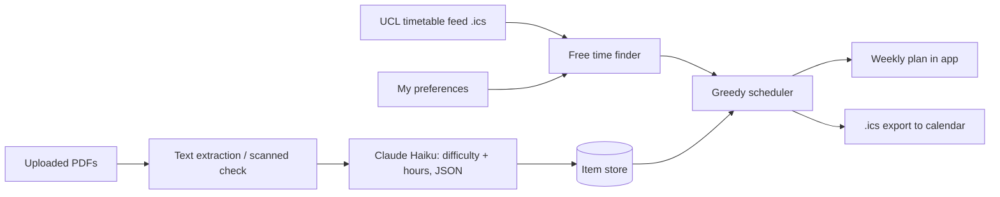

# UCL Study Planner

An app that reads my university timetable, rates the difficulty of my course material with an LLM, and builds a weekly study plan I can import into my calendar.

**[Live demo](https://YOUR-APP-LINK)** (made-up data; uploads are off in the public version)


## Why I built it
…two or three sentences in your own words: juggling 4 physics modules, material arriving weekly, never sure what to start first…

## How it works



1. **Timetable:** reads my UCL timetable feed, expands repeating events, and handles BST/GMT.
2. **Free time:** takes away lectures and regular commitments within my study hours, and marks my best-focus hours.
3. **Difficulty scoring:** sends the text (or, for scanned PDFs, the page images) to Claude Haiku 5.5 with a rubric. Structured outputs guarantee valid JSON.
4. **Scheduler:** greedy, so the most urgent item goes first, notes before problem sheets, hard items in focus hours, a daily cap, and at most 2h of one item per day.
5. **App:** Streamlit with drag-and-drop upload, a ranking table, the 7-day plan, warnings, and calendar export.

## Evaluating the AI
I rated each item myself **before** scoring it, then compared the two.

| Prompt | Difficulty error (MAE) | Within 1 point | Hours error (MAE) | Hours bias |
| --- | --- | --- | --- | --- |
| v1 (basic) | 0.75 | 100% | 5.88h | +5.88h |
| v2 (rubric + time guide) | 0.50 | 100% | 0.75h | +0.75h |

Prompt v2 cut the time-estimate error by about 87%.
…add your 6-item result here…

**Limitations:** only a few items so far, so the numbers are noisy. v2 was tuned on the same items it was tested on, so I'm continuing to evaluate it on new material each week. The model still avoids the extremes (1 and 5).

## Privacy by design
- Secrets (timetable link, API key) live only in `.env`, never in code.
- Course material, ratings and personal preferences stay in git-ignored folders.
- The public demo uses made-up data and never calls the API.
- Locally, the app only listens on localhost.

## Limitations and next steps
- The greedy scheduler isn't guaranteed optimal. Next: an optimiser (OR-Tools / PuLP).
- Log how long items actually take, and train a small regression model to correct the LLM's estimates.
- Pull assignment deadlines automatically from the Moodle calendar feed.
- Sync to Google Calendar via its API instead of manual import.

## Run it locally
```bash
git clone https://github.com/julianayordanova16-arch/ucl-study-planner.git
cd ucl-study-planner
python3 -m venv .venv && source .venv/bin/activate
pip install -r requirements.txt
cp prefs.example.yaml prefs.yaml        # then edit with your own routine
# create .env with TIMETABLE_ICS_URL="..." and ANTHROPIC_API_KEY="..."
streamlit run app.py
```

## Tech
Python · pandas · icalendar · pypdf · Claude API (Haiku 5.5, structured outputs, PDF input) · Streamlit